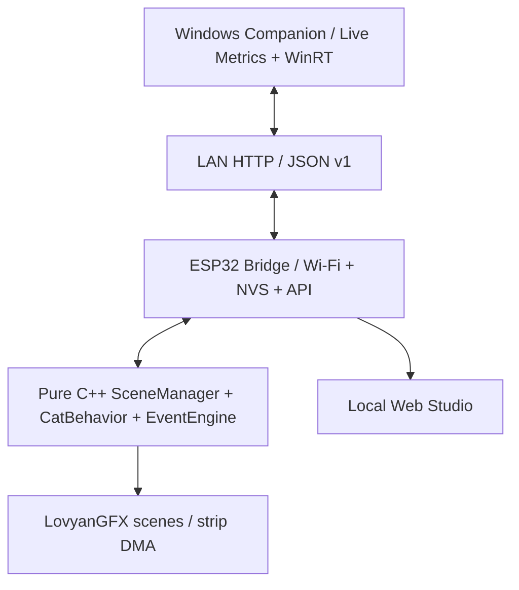

# Architecture baseline: modular monolith

MèoDesk v1.0 intentionally keeps three units: the ESP32 device, a Windows
process, and a shared versioned HTTP/JSON contract. **No broker, cloud
dependency, second firmware application, or framework migration.**

### Stable boundaries

1. **Domain:** `firmware/src/core` has no Arduino, Wi-Fi or display imports.
   Commands are single-slot, pending up to 8 seconds, sequential and ACKed.
   `MediaState` and `FocusTimer` timestamps derive from ESP32 `millis()`, not
   Windows clock. `EventEngine` stores a fixed bounded ring with priority and
   event expiration; no heap allocation or tasks are introduced.
   In v1.0, `SceneManager` keeps four favorite legacy page IDs, while
   `CatBehavior` owns virtual persona/energy and mood dwell time. Neither
   imports Wi-Fi, JSON, Arduino or the display library.
2. **Transport:** versioned endpoints `/api/v1/*`; v0.7.1 routes are stable.
   Agent's `companion_core` never imports Qt or WinRT directly, only optional
   provider `media_provider`. GUI can be redesigned without rewriting sensors.
3. **Display:** existing LovyanGFX renderer retains 144×16 RGB565 DMA strips,
   162×120 offscreen card sprite, pacing with `FramePacer` at a configurable
   50/40/33.3ms target, no full-screen redraw
   in frame loop. Cat mood crossfade now blends RGB565 per pixel into those
   same strips, retaining one source image and one previous-image pointer.
   Night mode remaps the originally flattened cream sprite background;
   it does not require alpha sprites or another large framebuffer.
   `src/main.cpp` is still a renderer-heavy compatibility module;
   extract additional scenes into files incrementally, without changing API.
   v1.1 N16R8 memory policy allocates internal DMA first; ordinary card
   sprites prefer internal RAM with PSRAM fallback, while transient cover-art
   buffers prefer PSRAM. Target FPS is never treated as measured FPS.
4. **Discovery:** no fixed IP; last known address, `meodesk.local`, fallback
   `192.168.4.1`; opt-in scan limited to private /24 networks. No external API.
5. **Configuration:** ESP32 NVS owns Wi-Fi settings, Windows Credential Manager
   owns pairing token. Windows JSON contains only nonsecret GUI settings/IP.
6. **Compatibility:** new Windows app still POSTs `/api/telemetry`, so old
   firmware works. Firmware v1.0 also accepts the old CLI/tray agent.
   The new telemetry fields are optional, preserving protocol `schema: 1`.

### Volatile album artwork data plane (v1.0)

1. Windows reads a real SMTC thumbnail only if the track identity changes.
2. Optional Pillow crops to 64×64, packs 8,192 RGB565 bytes in **little-endian**
   byte order, and computes a 16-hex song content ID.
3. Windows posts ordinary media JSON (with optional `artwork_id`) then sends
   multipart to authenticated `/api/v1/artwork` with the same content ID.
4. ESP32 checks the pairing key, exact 8,192-byte size and current song ID,
   copies the complete staged frame into volatile PSRAM (or internal SRAM
   fallback if PSRAM is unavailable) and exposes
   an authenticated BMP24 view for Web Studio.
5. The TFT draws this image inside the Music card, otherwise it falls back to
   unchanged text-only Now Playing. No new full-screen framebuffer is needed.

Artwork costs two 8,192-byte fixed buffers, is never written to flash, and
cannot interrupt CPU telemetry when no thumbnail is provided.

### Expanding safely

- Additional device: per-device registry entry + pairing key; no change to
  `collect_real` sensor provider. A *single* active device is deliberately
  supported in v1.0; multiscreen fanout comes in a separate feature module.
- New Windows integration (Spotify, OBS, HWiNFO): implement another provider
  returning a typed data snapshot; advertise a new optional capability.
- New cat mood: update `MoodEngine`/`CatBehavior`, asset mapping and tests,
  not Wi-Fi or DMA driver.
- Additional hardware sensor: add optional JSON field, keep old fields, mark
  unsupported readings null, test both old/new clients.
- OTA: only after checking flash partition feasibility, safe rollback and asset
  size; do not silently replace `huge_app` with a partition scheme that cannot
  fit the full application.

### Security notes

Access control is a single pairing key sent as `X-MEO-KEY` over HTTP. The
network must be trusted, and the AP password and pairing key should be changed
from factory/demo values. The public `/api/status` intentionally exposes
machine identity/load but no pairing or Wi-Fi password. A future version
should separate read-only and control credentials and support device-scoped
key rotation before opening access beyond a personal LAN.
