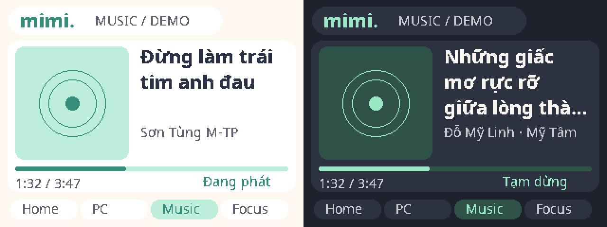

# Music rộng và font tiếng Việt

Mốc nguồn v2.10.0-dev mở rộng cảnh Music trên TFT 320×240. Vùng nội dung dùng 304×160 thay ô 162×120 trước đây. Trong cảnh này, ảnh bìa và thông tin bài hát thay vùng mèo; các cảnh khác giữ bố cục cũ.

- Ảnh bìa hiển thị 120×120, lấy từ dữ liệu RGB565 64×64 hiện có. Phóng to không bổ sung chi tiết ảnh; không thay giao thức artwork hoặc yêu cầu agent cũ nâng cấp để gửi ảnh.
- Tên bài dùng font đậm 20px, tối đa ba dòng; nghệ sĩ dùng font 14px, tối đa hai dòng. Cắt theo độ rộng đã đo và ranh giới ký tự UTF-8, có dấu ba chấm khi quá dài.
- Font nhúng là subset Noto Sans, gồm ký tự tiếng Việt dạng NFC, Latin và một số dấu câu. Ký tự ngoài subset hiển thị `?`; đây chưa phải bộ font đầy đủ cho mọi ngôn ngữ.
- Windows chuẩn hoá metadata Unicode NFC và loại ký tự điều khiển trước khi giới hạn số byte. Hợp đồng title 64 byte, artist 48 byte và envelope 512 byte vẫn được giữ.
- Canvas metadata tuỳ chọn dùng 79.040 byte PSRAM. Nếu cấp phát thất bại, vẽ trực tiếp trong vùng Music. Ảnh/tên bài chỉ vẽ lại khi metadata hoặc trạng thái khả dụng thay đổi; timeline vẽ riêng mỗi 500ms. Không vẽ lại toàn màn hình trong vòng lặp.
- DMA mèo không ghi vào Music. Dòng thông báo thông thường không chiếm vùng bài hát; cảnh báo critical vẫn hiện badge ALERT ở header.
- Music Web rộng toàn workspace, có bố cục dọc khi màn hẹp và giữ các nút điều khiển qua hàng đợi ESP32. Windows có ảnh bìa 220px và tên bài lớn; điều khiển nhạc vẫn ở Web Studio hoặc trình phát PC. Không thêm điều khiển volume/shuffle giả.

Ảnh trên dùng bitmap font nhúng để mô phỏng bố cục, không phải ảnh chụp từ thiết bị. Màu, metering của LovyanGFX, cập nhật artwork và SPI cần kiểm tra trên TFT thật.

Font và nguồn tái tạo: [generator](../firmware/tools/make_music_fonts.py), [font nhúng](../firmware/src/render/music_fonts.h), [giấy phép SIL OFL](../firmware/licenses/NotoSans-OFL.txt). Generator ghi SHA-256 của hai font nguồn; font nguồn đầy đủ không cần nằm trong firmware.

Kiểm thử: xác thực UTF-8 hợp lệ/không hợp lệ và byte bị cắt; chuẩn hoá tên bài tách dấu; kiểm tra bitmap của mọi tổ hợp nguyên âm/dấu tiếng Việt trong cả hai font; hồi quy Python/JavaScript và build firmware. Chưa OTA lên bo trong đợt này.
