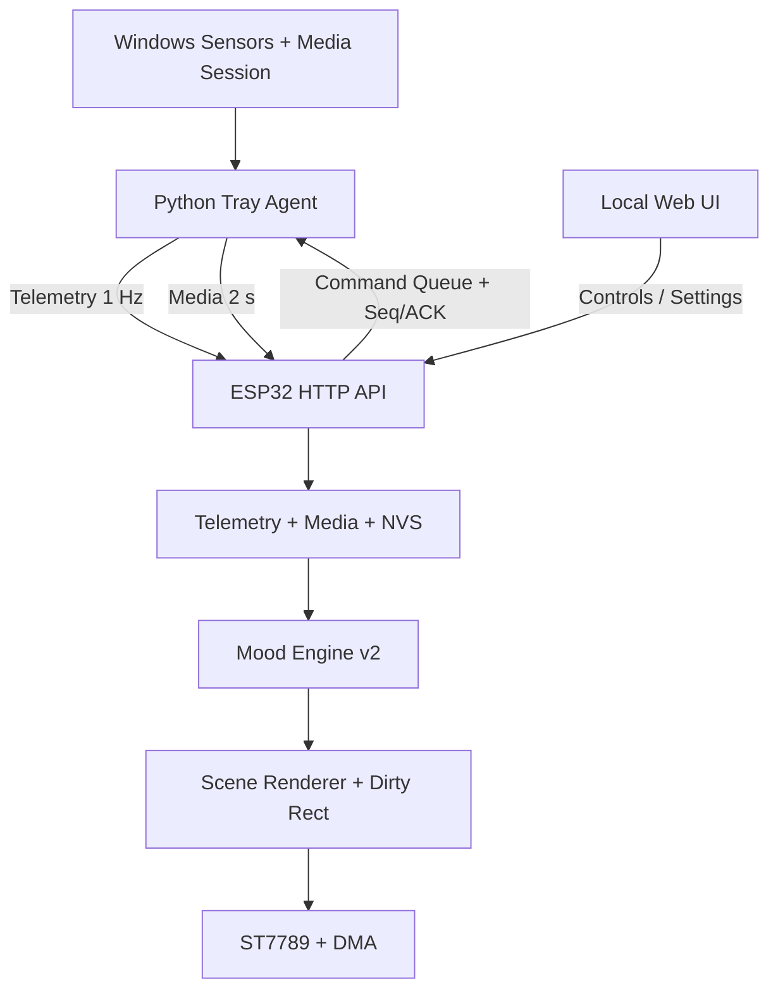
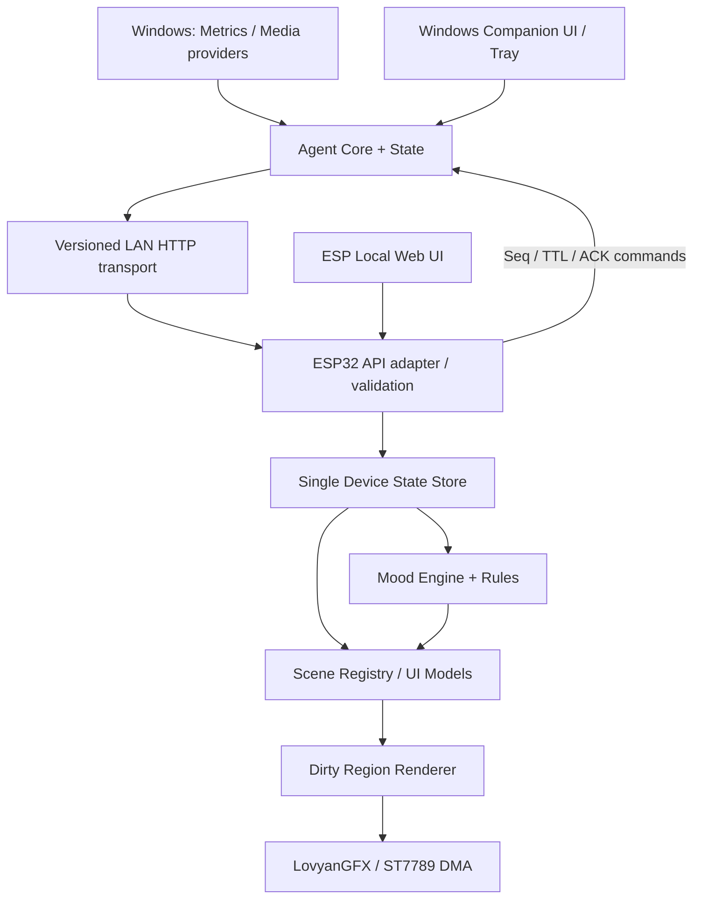

# MèoDesk v0.8 — Smart Desk Hybrid (archived design)

> Historical architecture/design proposal from the v0.8 planning phase.
> This is **not** the current release contract. See `../README.md`,
> `ARCHITECTURE.md`, and `../protocol/compatibility.md` for the v1.0 source.

**Trạng thái:** Đặc tả thiết kế và kế hoạch triển khai; **chưa phải firmware v0.8**.  
**Nền tảng:** ESP32-S3 DevKitC + ST7789 SPI 2.4″ (320×240 ngang), PlatformIO/Arduino, LovyanGFX, DMA, Windows Python agent và Web UI.  
**Mục tiêu:** Biến thiết bị đọc thông số PC thành một bạn mèo để bàn thông minh: thông tin **thật**, hoạt cảnh có ngữ cảnh, nhạc đang phát và điều khiển hai chiều, đồng thời giữ tính mượt và khả năng phục hồi của v0.7.1.

## 1. Baseline v0.7.1 — không làm mất tính năng

- Màn hình 320×240; SPI 40 MHz; SCK GPIO12, MOSI GPIO11, CS GPIO10, DC GPIO9, RST GPIO8. Đèn nền hiện nối 3V3, không thể điều chỉnh độ sáng chỉ bằng phần mềm.
- 16 sprite mèo RGB565 144×144; 12 trang hiện tại; 2 DMA strip 144×16 (~9 KiB tổng); sprite card 162×120 (~38 KiB); hoạt cảnh đo được ~19,6 FPS.
- Windows agent đọc CPU, GPU, RAM, pin, uptime; CPU temperature có thể `null`; dữ liệu `demo=false` là thật. Agent POST `/api/telemetry` ở 1 Hz. Dashboard web có 5 phút lịch sử, trạng thái/mood và điều khiển bằng pairing key.
- Các API đang có `/api/status`, `/api/history`, `/api/telemetry`, `/api/control`, `/api/settings`, `/api/cat.bmp` **giữ tương thích**. Hệ thống fallback AP `MEO-DESK-05` vẫn hoạt động khi mất router.
- Wi-Fi hiện vận hành trên mạng FPT; không gắn cứng IP của router vào firmware hay agent. Khóa điều khiển/telemetry không phải mật khẩu Wi-Fi.

## 2. Phạm vi bản v0.8

**Bắt buộc:** bốn chế độ TFT mới; hệ thống ưu tiên cảm xúc mèo; đọc Now Playing từ Windows khi ứng dụng hỗ trợ; thêm kênh Media và điều khiển nhạc hai chiều có ACK; Wi-Fi Manager lưu NVS; giữ tương thích với agent cũ; diagnostics hiệu suất.

**Tùy chọn nếu còn ngân sách tài nguyên:** micro-animation hạt/trái tim, thanh trượt chuyển cảnh, điều khiển bằng phím Web UI/PWA.

**Không làm trong v0.8:** OTA, thu âm/micro, loa, touch screen, FPS game, web cloud, servo; những hạng mục này thuộc v0.9–v1.0 và cần thêm phần cứng hoặc nguồn dữ liệu đáng tin cậy.

## 3. Design system và bố cục màn TFT

### 3.1. Nhận diện

Phong cách **Cozy Tech / Mimi**: nền màu kem, bề mặt trắng ấm, điểm nhấn mint và coral, hình mèo sẵn có là chủ thể. Ít khung viền, số lớn dễ đọc từ khoảng cách 0,5–1 m. Tránh phong cách dashboard công nghiệp với nhiều đồng hồ tròn bé.

| Token | Màu | Ứng dụng |
|---|---|---|
| Canvas | `#FFF8F1` | nền TFT |
| Paper | `#FFFFFF` | thẻ thông tin |
| Ink | `#2B3145` | văn bản chính |
| Secondary | `#7E8294` | nhãn phụ |
| Mint | `#BDEEDC` | hoạt động bình thường |
| Teal | `#358E7B` | trạng thái online |
| Coral | `#EC7770` | cảnh báo |
| Lavender | `#E2D7FA` | âm nhạc/tập trung |
| Gold | `#FDCC66` | pin/sự kiện vui |

**Các vùng, tọa độ pixel (gốc trên-trái):**

| Vùng | Hình học | Quy tắc |
|---|---|---|
| Header | `x=10..309; y=8..39` | tên chế độ, giờ, biểu tượng Wi-Fi/PC |
| Content | `x=10..171; y=49..200` | tiêu đề, số lớn, tối đa 3 thông số/1 trang |
| Cat zone | `x=176..319; y=49..192` | sprite 144×144; giữ vùng DMA riêng |
| Footer | `x=10..309; y=205..239` | 4 chỉ thị HOME · PC · MUSIC · FOCUS, trang đang chọn nổi bật |

**Quy tắc:** số lớn 26–32 px, nhãn chính 12–15 px, nhãn phụ tối thiểu 10 px nếu có thể; chỉ cập nhật vùng thay đổi. Trang chuyển thì có thể vẽ lại nền một lần, còn vòng lặp 20 FPS không vẽ toàn màn hình.

### 3.2. Bốn chế độ chính

| Chế độ | Nội dung và hành vi | Tương tác |
|---|---|---|
| **HOME** | giờ thật NTP; thứ/ngày; thời điểm PC gửi mẫu cuối; mèo vui/ngủ; chip CPU/RAM nhỏ; trạng thái Wi-Fi/PC | chuyển trang, chọn 12/24h từ web |
| **PC** | CPU % nổi bật; GPU %, nhiệt độ GPU/CPU nếu có; RAM %; cảnh báo và biểu đồ mini 60s; mèo phản ứng theo tải | chọn ưu tiên số liệu, cảnh báo từ web |
| **MUSIC** | `NOW PLAYING`, bài hát, nghệ sĩ, play/pause, thanh thời gian; mèo tai nghe; khi không có ứng dụng hỗ trợ hiển thị `Nothing playing` | play/pause, previous/next qua web; ESP gửi lệnh sang Windows agent |
| **FOCUS** | timer 25/5 phút; tiến độ; mèo tập trung/ngủ; nhạc chỉ hiển thị badge nhỏ khi đang phát | start/pause/reset bằng web/serial |

Các trang v0.7.1 như Health, Trends, System, Network, Printer, Moto **không xóa**; chuyển chúng thành màn phụ trong Web UI và/hoặc phím mở rộng. Điều này giảm số lần người dùng phải cuộn qua 12 trang trên TFT.

### 3.3. Motion specification

- Mèo: mục tiêu 20 FPS ổn định (~50 ms/frame), giữ 144×144 và DMA strip. Chuyển biểu cảm có easing 180–250 ms, không nạp cả chuỗi bitmap kích thước lớn mỗi frame.
- CPU/GPU bar: lerp giá trị hiển thị trong 250–400 ms để không giật khi mẫu mới đến mỗi giây.
- Mèo chớp mắt/nhún 1–2 px trong các trạng thái bình thường; không dùng hiệu ứng mạnh khi Focus hoặc nhiệt độ/pin nguy hiểm.
- Các chuỗi `track title` dài chỉ cuộn trong vùng text có clipping; không chạy marquee liên tục ở mọi khung hình.
- Khi mất dữ liệu, hiển thị **N/A/PC WAIT**, không hiển thị lại số cũ như số hiện hành; web và TFT đều phân biệt REAL/DEMO/OFFLINE.

## 4. Mood Engine v2 — state machine xác định, không ngẫu nhiên hóa cảnh báo

### 4.1. Thứ tự ưu tiên

1. `PC_OFFLINE`: không có telemetry hợp lệ >6 s; **không coi mất router là mất PC nếu agent vẫn gửi qua AP**.
2. `LOW_BATTERY`: pin <=20% và **không sạc**; báo sớm.
3. `HOT`: CPU hoặc GPU temp >=80°C khi cảm biến tồn tại.
4. `STRESSED`: CPU >=88% hoặc GPU >=92% kéo dài.
5. `FOCUS`: người dùng đang bật phiên Focus.
6. `MUSIC`: Windows có phiên nhạc đang phát.
7. `SLEEP`: máy khóa hoặc tải nhẹ đủ lâu.
8. `HEALTHY`: mặc định.

Các ngưỡng xuất phát từ `HealthSettings` hiện tại, chỉnh được từ Web UI. Badge **Wi-Fi offline** là trạng thái mạng độc lập và không được che giấu cảnh báo sức khỏe PC.

| Trạng thái | Điều kiện vào đề xuất | Điều kiện rời/cooldown | Sprite ưu tiên |
|---|---|---|---|
| PC_OFFLINE | dữ liệu cũ >6 s | có mẫu hợp lệ mới | `cat_rescue` |
| LOW_BATTERY | <=20%, unplugged >=1,5 s | cắm sạc hoặc >=25% | `cat_shutdown` |
| HOT | >=80°C >=1,5 s | <=76°C >=5 s | `cat_health` |
| STRESSED | CPU>=88% hoặc GPU>=92% >=2,5 s | dưới (ngưỡng−6%) >=5 s | `cat_storage` |
| FOCUS | focus session active | kết thúc/pause; cảnh báo cấp cao có quyền ghi đè | `cat_paused` |
| MUSIC | phiên hợp lệ, `playing` >=1 s | paused/stale >3 s | `cat_music` |
| SLEEP | Windows locked hoặc CPU<20%, GPU<25% >=30 s | mở khóa/tương tác mới | `cat_sleep` |
| HEALTHY | mọi trạng thái bình thường khác | >=3,5 s để tránh nhấp nháy | `cat_healthy` |

**Tái dùng** `mood_filter.h`; mở rộng bộ chọn trạng thái thay vì viết lại 16 assets. `null`/chưa có cảm biến **không** được hiểu là 0°C hoặc 0% pin. GPU=0% lại là số đo hợp lệ. Các sự kiện ngẫu nhiên như thở/chớp mắt thuộc tầng **Idle Animation**, không ghi đè Mood Engine.

## 5. Now Playing từ Windows

### 5.1. Nguồn dữ liệu thật

Windows agent dùng API **Windows.Media.Control / GlobalSystemMediaTransportControlsSessionManager**. Chỉ đọc metadata ở những ứng dụng có phát hành phiên media cho Windows. Ưu tiên phiên đang phát; nếu nhiều phiên, chọn current session do Windows cung cấp. Metadata gồm title, artist, playback status, duration và position khi có. Không sử dụng Spotify key trong bản đầu; không đoán trạng thái nhạc từ tên tiến trình.

**Python implementation:** module riêng `windows_agent/media_provider.py`; thư viện WinRT phù hợp được khai báo **tùy chọn** và lỗi thiếu dependency không được làm hỏng đường CPU/RAM. Poll ngữ cảnh nhạc khoảng mỗi 2 giây hoặc dùng callback event khi khả dụng; cache immutable snapshot để thread gửi HTTP đọc không bị race.

### 5.2. Endpoint mới, giữ nguyên endpoint cũ

**PC → ESP**: `POST /api/media`, Header `X-MEO-KEY` như telemetry. Giới hạn body <=512 byte, title tối đa 64 UTF-8 bytes, artist tối đa 48; từ chối dữ liệu sai định dạng hoặc quá dài trước khi ghi RAM.

```json
{
  "schema": 1,
  "available": true,
  "playing": true,
  "title": "Sample Track",
  "artist": "Sample Artist",
  "position_ms": 45800,
  "duration_ms": 187000
}
```

Ví dụ tên bài hát chỉ minh họa cấu trúc. Không có session thì gửi `available:false` và các trường không biết là `null`; UI hiện `Nothing playing`. ESP timeout media nếu >10 s không có cập nhật và không phát lệnh nhạc cũ.

**ESP → Web**: `GET /api/media` trả snapshot `available`, `playing`, `stale`, `title`, `artist`, `position_ms`, `duration_ms`; các trường cần riêng tư có thể yêu cầu pairing key.

### 5.3. Điều khiển hai chiều có ACK

Web UI gửi `POST /api/control` với `action` thuộc `media_play_pause`, `media_next`, `media_previous`. ESP ghi hàng đợi vòng (4 lệnh), `seq` tăng dần, `created_ms` và TTL 8 s. Windows agent (không phải ESP) thực thi API media điều khiển Windows:

1. Agent gọi `GET /api/commands?after=<last_seq>` (header `X-MEO-KEY`), tối đa 1–2 Hz.
2. Nếu có lệnh mới, kiểm tra TTL/seq; chỉ thực hiện **một lần**.
3. Agent gọi `POST /api/commands/ack` với `{ "seq": 42, "ok": true }` hoặc lỗi.
4. Web UI hiển thị pending/ACK/timeout; không báo thành công khi chưa có ACK.

Khi agent offline, nút nhạc bị disable, không tích tụ lệnh để chạy dồn sau khi kết nối lại. Khi kết nối chập chờn, client nhớ `last_seq` tránh thực thi lặp lệnh. Với các player không hỗ trợ remote control, nút vẫn disabled hoặc trả lỗi rõ ràng. Không mở WebSocket mới trong bản đầu, vì HTTP polling hiện có dễ kiểm thử và ít thay đổi hệ thống.

## 6. Device & Web UI v0.8

Web UI tổ chức lại thành **Dashboard / Pet Studio / Music & Focus / Device Settings**.

- Dashboard: CPU/GPU/RAM, trend 5 phút, trạng thái real/demo/offline, cảm xúc đang kích hoạt và nguyên nhân.
- Pet Studio: chọn sprite preview; bật/tắt micro-animation; mapping ngữ cảnh, quiet hours; không cho preview ngắn hạn ghi đè cảnh báo thật mãi mãi.
- Music & Focus: metadata, play/pause/next/previous có ACK, timer Pomodoro, trạng thái phiên.
- Device Settings: Wi-Fi scan, lưu SSID/mật khẩu qua NVS, kết nối lại và rollback về AP nếu router không truy cập được; theme, thời gian, pairing key riêng thiết bị, FPS/heap/uptime.

**An toàn:** NVS giữ Wi-Fi và preferences xuyên reboot; không trả mật khẩu Wi-Fi trong GET/status, không in secret lên Serial. Không thay key mặc định mà không có đường chuyển đổi agent; cơ chế migration phải có màn xác nhận và cập nhật cấu hình agent Windows.

**Wi-Fi:** phần STA scan mới của v0.7.1 tiếp tục là bất đồng bộ. AP `MEO-DESK-05` luôn là lối phục hồi. Khi thử mật khẩu mới, giữ khả năng truy cập Web UI qua AP, chỉ ghi cấu hình mới khi đã kiểm tra kết nối thành công hoặc người dùng xác nhận, và có nút Factory Network Reset.

## 7. Kiến trúc phần mềm



**Firmware modules đề xuất:** `desk_state.{h,cpp}` (dữ liệu), `mood_engine.{h,cpp}` (ưu tiên/hysteresis), `scene_home/pc/music/focus`, `media_bridge.{h,cpp}` (snapshot và hàng đợi), `wifi_manager.{h,cpp}` (NVS/backoff/diagnostics), giữ `display_config.h`, `cat_assets` và các phần tương thích trong `pc_bridge`.

**Windows:** giữ `pc_agent.py`/`tray_agent.py`, tách `media_provider.py`, `transport.py` và `command_client.py` vừa đủ; không biến agent thành một service cần quyền Administrator. Mọi tính năng mới chạy được khi optional Media API không khả dụng: chỉ Music hiển thị trạng thái trống.

## 8. Budget hiệu năng và bộ nhớ

| Ràng buộc | Chỉ tiêu kiểm thử |
|---|---|
| Cat animation | trung bình >=19 FPS khi agent+Web UI hoạt động; không có freeze >500 ms do quét Wi-Fi/HTTP |
| RAM | free internal heap >=120 KiB sau 30 phút hoạt động thực; không rò rỉ tăng dần |
| Vẽ | không cấp phát framebuffer toàn màn 320×240 RGB565 (153.600 byte) trong heap nội bộ; giữ dirty rectangles/card sprite |
| DMA | buffer còn sống tới `waitDMA`; cấm ghi vào vùng đang DMA truyền |
| API | telemetry cũ vẫn nhận; media parse riêng, xử lý `null` và UTF-8 an toàn |
| Trải nghiệm | PC số liệu <=2 s so với mẫu Windows trong LAN ổn định; media <=4 s; lệnh nhạc xác nhận hoặc timeout <=8 s |
| Offline | PC WAIT đúng khi mất agent; Web UI/AP còn truy cập; không nhảy cảm xúc liên tục |
| Đèn nền | không hứa dimming PWM khi LED hiện vẫn nối trực tiếp 3V3 |

Nếu phần cứng có PSRAM mới xem xét sprite lớn trong PSRAM; DMA có thể cần buffer nội bộ và đo trên đúng board. Không coi PSRAM có sẵn nếu chưa đọc thông tin module.

## 9. Lộ trình triển khai thành từng checkpoint độc lập

| Mốc | Công việc | Kết quả để chấp nhận |
|---|---|---|
| **M0 — Baseline** | lưu nguyên ZIP v0.7.1/kiểm tra build & serial; khóa cấu hình SPI | firmware cũ chạy, PC telemetry & HTTP 200 như hiện tại |
| **M1 — TFT v0.8** | 4 layout Home/PC/Music/Focus từ mock JSON, chuyển trang và card sprite | không lệch text/nhấp nháy; >=19 FPS |
| **M2 — Mèo thông minh** | MoodEngine v2, overlay, idle animations; unit tests ngưỡng | không false positive khi GPU=0, CPU temp=null, pin đang sạc |
| **M3 — Windows Media** | provider thật, hỗ trợ player có media session, fixture tests; POST `/api/media` | bài hát/artist/playstate hiện thật; không có app thì N/A |
| **M4 — Lệnh PC** | queue seq/TTL/ACK, web controls, tests offline/duplicate | play/pause/next thực thi tối đa 1 lần/lệnh, ACK rõ ràng |
| **M5 — Device Studio** | NVS Wi-Fi Manager; cấu hình theme/key; preserving AP | đổi Wi-Fi không nạp lại code; không khóa thiết bị khi sai mật khẩu |
| **M6 — Regression** | chạy đồng thời agent, nhạc, Web UI, Wi-Fi reconnect 30 phút; đóng ZIP PlatformIO + Python | không crash, không leak heap, không phá v0.7.1 API; tài liệu và release note đầy đủ |

## 10. Test cases tối thiểu

1. `gpu_percent = 0.0` hiển thị **0%**, không coi là thiếu dữ liệu.
2. `cpu_temp_c = null` hiển thị **N/A** và không tự kích hoạt HOT.
3. `battery_percent = 100`, `battery_plugged=true` không kích hoạt LOW_BATTERY.
4. Ngắt agent >6 s: PC WAIT + mèo rescue; nối lại thì lấy mẫu mới, không giữ số cũ.
5. GPU nóng vượt 80°C liên tục >1,5 s: mèo cảnh báo; dưới 76°C lâu >5 s mới trả trạng thái bình thường.
6. Đổi bài nhanh 10 lần: TFT không giật; tên bài dài không tràn sang sprite mèo.
7. Mở YouTube/Spotify mà Windows không công bố media session: Music hiện `Nothing playing`, không đoán dữ liệu.
8. Nhấn Play/Pause liên tục khi agent offline: không thực thi lệnh cũ sau khi reconnect, có timeout.
9. Nhập sai mật khẩu Wi-Fi mới: AP dự phòng còn truy cập và có thể sửa lại từ Device Settings.
10. Web UI và Windows agent cũ dùng `/api/telemetry` vẫn hoạt động khi không cài Media provider.
11. Test mock có badge DEMO; số liệu thật và giả không lẫn nhau.
12. Đo FPS/heap với Web UI mở và trình phát nhạc đang chạy ít nhất 30 phút trên đúng ESP32-S3 + TFT.

## 11. Quyết định khóa thiết kế v0.8

- **Chọn:** Cozy Tech Hybrid; bốn màn hình chính, giữ các màn phụ; animation ổn định quan trọng hơn FPS tối đa; Media qua Windows API, không phụ thuộc Spotify key; HTTP + ACK trước khi nghĩ tới WebSocket; NVS Wi-Fi và fallback AP.
- **Giữ nguyên:** Python telemetry 1Hz, schema tương thích, chân TFT, asset mèo hiện có, token pairing hiện tại cho đến khi migration được xác nhận, phân vùng `huge_app` trong v0.8.
- **Để sau:** điều chỉnh đèn nền bằng phần cứng, loa/nút nhấn, vỏ in 3D, OTA. OTA đòi hỏi xem lại phân vùng có ít nhất hai app slot và kích thước firmware/asset; không làm chung trong đợt UI/Media.

### Nguồn kỹ thuật tham chiếu

- Espressif Arduino Preferences (NVS): https://docs.espressif.com/projects/arduino-esp32/en/latest/api/preferences.html
- Microsoft Windows Media Control: https://learn.microsoft.com/en-us/uwp/api/windows.media.control.globalsystemmediatransportcontrolssessionmanager
- Espressif ESP32-S3 External RAM: https://docs.espressif.com/projects/esp-idf/en/release-v5.5/esp32s3/api-guides/external-ram.html
- Espressif OTA partitions: https://docs.espressif.com/projects/esp-idf/en/stable/esp32/api-guides/partition-tables.html

## 12. Bổ sung: Windows Agent dạng ứng dụng — MèoDesk Companion

### 12.1. Sản phẩm đầu ra

**Tên:** `MeoDesk Companion` cho Windows 10/11. Bản phát hành mục tiêu là **installer/EXE mở bằng double-click**, tự kèm Python runtime và các thư viện bắt buộc. Không yêu cầu người dùng mở PowerShell, cài `pip` hoặc dùng quyền Administrator trong luồng hằng ngày.

**Đề xuất:** PySide6 (Qt Widgets + QSS) cho UI/tray, giữ phần lấy CPU/GPU/RAM từ `pc_agent.py`, đóng gói bằng PyInstaller `onedir`, phát hành qua một installer chạy per-user. Build và test installer trên **Windows** vì PyInstaller không cross-compile từ Linux sang Windows. QSystemTrayIcon đảm nhiệm menu Pause/Resume, Open Web, Exit.

Phân biệt hai bản:

1. **Release EXE (ưu tiên):** dependency bắt buộc đã được đóng gói, nên nút `Cài thư viện` không còn cần thiết. Chỉ hiển thị `Kiểm tra thành phần / Repair` khi phát hiện module tùy chọn thiếu.
2. **Source/Developer:** có cửa sổ bootstrap dùng Tkinter (thư viện chuẩn) để kiểm tra Python, tạo `.venv`, cài dependency từ danh sách đã khóa phiên bản và mở ứng dụng chính; không chạy `pip` bí mật khi người dùng chưa đồng ý.

### 12.2. Hành trình người dùng: cài một lần, tự chạy về sau

**Lần đầu:** tải installer → Next → mở Companion → tự tìm thiết bị → chọn `MèoDesk (192.168.0.107)` nếu vẫn đúng IP → nhập pairing key (không phải mật khẩu Wi-Fi) → `Kiểm tra kết nối` → `Start Streaming` → chọn `Run at Windows login` nếu muốn.

**Lần sau:** đăng nhập Windows → ứng dụng xuất hiện ở system tray và tự kết nối thiết bị nhớ trước đó; mất Wi-Fi thì retry có backoff, không hiện console và không spam popup. Khi IP đổi, tự tìm lại thiết bị trên LAN.

**Khi không tìm thấy:** nhập IP hoặc `meodesk.local` thủ công → Verify → Save Device. Người dùng có thể chọn không tự quét mạng.

### 12.3. Cấu trúc giao diện Companion (khoảng 840×560 trên Windows)

| Khu vực | Thành phần |
|---|---|
| Header | logo mèo; thiết bị được chọn; chấm `CONNECTED / STREAMING / DISCONNECTED`; thời gian mẫu cuối |
| Overview | CPU, RAM, GPU và nhiệt độ/pin thật, chú thích `N/A` khi không có cảm biến; nút Start/Pause/Stop |
| Devices | danh sách thiết bị tìm thấy, IP và SSID/firmware (nếu có), `Scan LAN`, ô nhập IP, `Test Connection`, nhập pairing key |
| Integrations | lựa chọn GPU auto/NVIDIA/LHM, trạng thái CPU temperature provider, Now Playing available/unavailable, lựa chọn cài module tùy chọn |
| Settings | tự khởi động, khởi động thu nhỏ, telemetry interval 1s, media interval 2s, theme Light/Dark |
| Diagnostics | HTTP status, độ trễ gửi, lỗi 401 / timeout / unreachable, xuất log đã che key, mở Web UI |

Phong cách cùng Cozy Tech: kem ấm, lavender, mint; không dùng giao diện `pip`/Terminal làm trải nghiệm chính. Khi người dùng thu nhỏ/đóng cửa sổ, mặc định ẩn vào tray; Exit trong tray mới dừng hoàn toàn. Phải có tùy chọn tắt hành vi này để tránh hiểu nhầm ứng dụng vẫn chạy.

### 12.4. Tìm IP ESP32 trên mạng LAN

**Ưu tiên theo thứ tự:**

1. Thử IP lưu lần trước (ví dụ hiện tại `192.168.0.107`) với timeout ngắn. IP chỉ là địa chỉ ưu tiên, không hard-code.
2. Thử `meodesk.local` qua mDNS (nếu Windows/router hỗ trợ).
3. **V0.8 firmware mới:** hỗ trợ UDP discovery LAN trên cổng cố định được công bố trong tài liệu, trả `device_id`, `name`, `ip`, `port`, `firmware_version`, `capabilities`. Không trả mật khẩu Wi-Fi hay pairing key.
4. Nếu vẫn không có kết quả, tùy chọn quét **subnet IPv4 riêng của máy người dùng** (không scan Internet): thử HTTP `/api/status`, xác thực JSON phải có `device == "MEO DESK"`. Giới hạn tối đa 16 kết nối song song, timeout 300–500 ms/máy, hủy được.
5. Luôn có **ô nhập IP thủ công** và nút Verify. Không bắt buộc mDNS hay UDP mới dùng được app.

**Các trạng thái cần phân biệt:** `DEVICE_FOUND` (GET status thành công), `PAIRING_REQUIRED` (test authenticated endpoint 401), `STREAMING` (ESP xác nhận nhận telemetry), `OFFLINE` (timeout/network). Không hiển thị Connected chỉ vì Windows đang nối Wi-Fi.

**Thiết bị cũ v0.7.1:** chưa có UDP discovery thì vẫn dùng last IP, mDNS, HTTP LAN scan và manual IP. Chế độ tìm thiết bị mới là nâng cấp tương thích, không điều kiện bắt buộc để agent hoạt động.

### 12.5. Vòng đời, lưu cấu hình, bảo mật

- Config không bí mật (`last_ip`, `device_id`, interval, theme, auto_start) nằm dưới `%LOCALAPPDATA%\MeoDesk\config.json`; log tại `%LOCALAPPDATA%\MeoDesk\logs` và giới hạn dung lượng/quay vòng.
- Pairing key lưu bằng Windows Credential Manager hoặc DPAPI theo tài khoản user; không lưu plaintext trong config và không hiện trên log/ảnh chụp diagnostics.
- Windows đã kết nối Wi-Fi thì **agent không cần SSID/mật khẩu Wi-Fi**. Cấu hình mạng cho ESP32 chỉ qua Device Settings với xác nhận, không âm thầm lưu lại mật khẩu Wi-Fi trong Windows agent.
- Xử lý multi-instance: chỉ một worker gửi telemetry cho một thiết bị; nhấp icon hai lần chỉ mở lại cửa sổ, không chạy thêm process/stream.
- Không yêu cầu admin để chạy, không mở HTTP inbound trên Windows; chỉ kết nối outbound đến IP ESP32 trên LAN. Khi LAN client isolation bật, app phải báo rõ không thể liên lạc.
- `MEO_API_KEY` hiện mặc định được hỗ trợ để không phá v0.7.1; v0.8 thêm quy trình tạo key riêng và cập nhật vào agent sau khi pair. Không coi key mặc định là bảo mật mạnh trên mạng lạ.
- `Start with Windows` chỉ đăng ký Startup per-user khi người dùng bật; `Uninstall` gỡ shortcut, giữ/loại cấu hình tùy lựa chọn.

### 12.6. Các tính năng Companion ưu tiên

| Tính năng | Bản v0.8 | Giai đoạn sau |
|---|---|---|
| Tự phát hiện IP, manual IP, pairing | **Bắt buộc** | nhiều ESP32 cùng lúc |
| CPU/GPU/RAM, pin, GPU temp thật | **Bắt buộc, tái dùng core** | disk/net bandwidth |
| Now Playing + điều khiển nhạc | **Bắt buộc** nếu player hỗ trợ | ảnh album lớn và playlist |
| System tray, chạy cùng Windows | **Bắt buộc** | mini floating widget |
| Cửa sổ diagnostics + export log | **Bắt buộc** | biểu đồ PC 24 giờ |
| CPU temperature | Có LHM thì thật; nếu không **N/A** | tích hợp thêm sensor provider |
| Tương tác mèo (đổi mood từ desktop) | Ở mức preview/quiet/focus | cho ăn, level, achievements |
| Bambu Lab A1 local printer status | Chỉ nghiên cứu nếu có giao thức/ủy quyền | add-on chính thức |
| USB-serial fallback | Chưa có | chỉ nếu giải quyết xung đột Serial monitor |

### 12.7. Phân chia module Windows

```text
windows_agent/
  core/telemetry.py        # psutil + NVML + optional LHM; giữ dữ liệu thật
  core/media_provider.py   # Windows Media Session, không chặn telemetry
  core/transport.py        # POST /api/telemetry, /api/media
  core/discovery.py        # last IP, mDNS, UDP, HTTP LAN scan
  core/commands.py         # GET commands, ACK, TTL/sequence
  core/settings.py         # config, secret storage, migration
  gui/main_window.py       # PySide6 Overview/Devices/Settings
  gui/tray.py              # QSystemTrayIcon, menu Pause/Resume/Exit
  bootstrap.py             # Tkinter setup dành riêng cho chạy từ source
  pc_agent.py              # CLI legacy vẫn còn để debug
  tray_agent.py            # shim/migration cho người dùng cũ
```

### 12.8. Mốc triển khai cho Windows app

| Mốc | Tập trung | Điều kiện nghiệm thu |
|---|---|---|
| **A0** | tách collector/HTTP khỏi CLI, giữ unit tests cũ | CLI hiện tại vẫn gửi được RTX 3050, CPU/RAM, GPU temp; `cpu_temp=null` đúng |
| **A1** | PySide6 UI + QSystemTrayIcon, single-instance | mở không console, đóng về tray, Resume/Stop ổn |
| **A2** | discovery 4 bước và manual IP | tìm/verify `192.168.0.107` nếu còn đúng; fallback khi mDNS lỗi |
| **A3** | setup/pairing + cấu hình lưu/khôi phục | thông báo 401 rõ ràng, không lộ key, nhớ thiết bị sau reboot |
| **A4** | Windows media + command client | đọc nhạc thật, ACK lệnh, không thực thi lặp |
| **A5** | PyInstaller onedir Windows + installer per-user | máy Windows sạch **không cài Python** vẫn double-click mở/stream |
| **A6** | smoke test 30–60 phút, Windows login, Wi-Fi reconnect | GUI không treo, không rò RAM, không lặp worker, lỗi dễ hiểu |

**Chấp nhận v0.8 Companion:** người dùng tải một installer, mở ứng dụng, tìm/chọn ESP hoặc nhập IP, Pair và Start; lần sau chỉ cần đăng nhập Windows. Chức năng cập nhật/cài optional provider không được chặn đường CPU/GPU/RAM cơ bản.

### Tham chiếu mới

- Qt for Python QSystemTrayIcon: https://doc.qt.io/qtforpython-6/PySide6/QtWidgets/QSystemTrayIcon.html
- PyInstaller (bundling runtime, build trên Windows): https://pyinstaller.org/en/stable/
- Microsoft DPAPI: https://learn.microsoft.com/en-us/windows/win32/api/dpapi/nf-dpapi-cryptprotectdata

## 13. Architecture Baseline — chốt kiến trúc tránh refactor lớn về sau

**Quyết định duy nhất:** Một **modular monolith trong monorepo**, kết nối bằng **HTTP/JSON protocol có phiên bản**, Windows Companion dùng **provider plugins**, ESP32 có **State Store + Mood Engine + Scene Renderer**, driver LovyanGFX/DMA được giữ nguyên. Không chuyển sang microservices, MQTT broker, LVGL hoặc viết lại bằng framework khác ở giai đoạn này. Tính mở rộng đến từ các **hợp đồng ổn định** giữa module, không từ việc tạo nhiều lớp trừu tượng không cần thiết.

### 13.1. Quy tắc không được vi phạm

1. **Domain không phụ thuộc UI/network:** cảm biến, MoodEngine, command và media nhận các struct dữ liệu đã xác thực; không gọi `WiFi`, `WebServer`, `Serial` hay LovyanGFX bên trong logic quyết định.
2. **Renderer không biết HTTP:** nhận `DeskSnapshot` và danh sách vùng dirty; driver chỉ lo SPI, sprite, DMA và kích thước màn.
3. **Agent không biết TFT:** providers trả `MetricSample`/`MediaSample`; transport chịu trách nhiệm gửi; GUI đọc trạng thái từ core, không gọi trực tiếp driver cảm biến trong callback nút.
4. **Giao thức có phiên bản:** thay đổi chỉ thêm trường tùy chọn trong cùng major; phá tương thích phải tăng major và có migration/compatibility adapter.
5. **Mock là nguồn dữ liệu tách biệt:** mọi field có trạng thái REAL/DEMO/UNAVAILABLE; không thay `null` thành 0 và không để demo âm thầm đi vào màn số liệu thật.
6. **Chỉ một người sở hữu trạng thái:** một `StateStore` trên firmware, một `AgentState` trên Windows; tránh nhiều biến global trùng nhau và multiple definitions `setup()/loop()`.
7. **Cấu hình thuộc đúng bên:** Wi-Fi trên ESP32 NVS, pairing key Windows vault, IP trong Windows device registry, GUI theme ở Windows config. Không hardcode IP/SSID/password vào core.
8. **Mỗi mốc có đường quay lại:** bản đang chạy luôn được giữ; feature flags/capabilities cho phép nâng cấp hai phía không đồng thời.

### 13.2. Luồng dữ liệu mục tiêu



**Cadence đề xuất:** agent telemetry 1 Hz, media khoảng 2 s hoặc on-change, web status 1–3 s, cat animation ~20 FPS. Tần suất thay đổi thuộc scheduler, không đóng cứng vào UI hoặc parser.

### 13.3. Cấu trúc monorepo được chọn

```text
meodesk/
  firmware/
    platformio.ini
    include/                         # public contracts C++
    src/
      app/main.cpp                   # chỉ setup, loop, composition
      core/device_state.*            # canonical state, timestamps, quality
      core/mood_engine.*             # rule, debounce/hysteresis
      core/command_queue.*           # bounded queue, seq, ack, TTL
      core/settings.*                # schema + migration
      services/http_api.*            # REST + JSON validation
      services/network_manager.*     # STA, AP, async scan, reconnect
      services/discovery.*           # mDNS, UDP device identity
      ui/scene_registry.*            # Home, PC, Music, Focus, legacy
      ui/scene_models.*              # view models, not drivers
      ui/dirty_renderer.*            # partial redraw policy
      drivers/tft_lgfx.*             # pins, DMA, SPI, sprites
      assets/                         # generated RGB565/manifest
  windows_agent/
    core/providers/                  # psutil, NVIDIA NVML, LHM, Media
    core/state.py                    # validated immutable snapshots
    core/transport.py                # HTTP today, changeable later
    core/discovery.py                # last IP / mDNS / UDP / manual
    core/command_client.py           # replay-safe ACK logic
    gui/                              # PySide6 main, tray, settings
    packaging/windows/               # PyInstaller spec, installer assets
    pc_agent.py                       # compatibility CLI
  protocol/
    schemas/                         # versioned JSON schemas
    fixtures/                        # live, mock, missing, malformed
    compatibility.md                 # firmware x agent matrix
  assets/source/                      # original PNG, not generated headers
  tools/                              # deterministic image convert / bundle
  tests/
    unit/                             # mood, settings, command state
    contract/                         # JSON protocol, old/new compatibility
    simulation/                       # mock device + mock Windows agent
    hardware/                         # ESP32/TFT smoke procedure + benchmarks
  docs/                               # architecture, ADRs, wiring, release notes
  .github/workflows/                   # CI build/test/release
```

Đây là **cấu trúc đích**, không phải yêu cầu đổi tên tất cả file trong một commit. Di chuyển module theo từng checkpoint, giữ `main.cpp` hoạt động giữa các bước. Các adapter được viết sau khi có interface sử dụng thực, tránh overengineering.

### 13.4. Hợp đồng dữ liệu và phiên bản

Tách độc lập: `firmware_version`, `agent_version`, `api_major/api_minor`, `config_schema_version`. Không dùng số `v0.8` để ngầm định mọi phía luôn phải nâng cấp đồng thời.

`GET /api/status` ở firmware mới trả thêm các trường **tùy chọn**:

```json
{
  "device": "MEO DESK",
  "device_id": "mdsk-example-001",
  "firmware_version": "0.8.0",
  "api_version": { "major": 1, "minor": 0 },
  "capabilities": ["telemetry.v1", "media.v1", "commands.v1", "wifi_config.v1"],
  "pc_connected": true
}
```

Đây là **hợp đồng đề xuất**; `device_id` và version trong ví dụ không phải ID/IP thật. `device_id` tạo ngẫu nhiên một lần và giữ trong NVS, không phụ thuộc DHCP/IP và không cần công khai toàn bộ MAC.

Quy tắc parse:

- Input giới hạn độ dài, số liệu và UTF-8; trường lạ bỏ qua an toàn; trường bắt buộc thiếu trả HTTP 400 có mã lỗi.
- Dữ liệu nhận được có `seq` để bỏ gói trùng; thời gian `last_received_ms` tính bằng `millis()` **tại thiết bị**, không so đồng hồ Windows với ESP32 để quyết định stale.
- Field vắng mặt và `null` là **UNAVAILABLE**; `0` là dữ liệu hợp lệ khi trong khoảng.
- API hiện tại như `/api/telemetry` và `/api/control` vẫn được phục vụ qua compatibility handlers. Feature mới đặt trong namespace có phiên bản (`/api/v1/...`) hoặc được cấp capability tương ứng.
- Command queue chỉ chấp nhận allowlist action; mỗi lệnh có `seq`, `ttl_ms`, ACK; không hỗ trợ chạy lệnh shell tùy ý từ web qua PC.

**Bảng tương thích:**

| Firmware | Windows Agent | Kết quả bắt buộc |
|---|---|---|
| 0.7.1 hiện tại | Agent cũ | telemetry và Web UI như hiện tại |
| 0.7.1 hiện tại | Companion 0.8 | telemetry bình thường; Media/Commands được tắt theo capability |
| Firmware 0.8 | Agent cũ | telemetry cơ bản, mood fallback; không crash do thiếu Media |
| Firmware 0.8 | Companion 0.8 | đầy đủ các capability hai phía đều báo hỗ trợ |

### 13.5. Bộ nhớ, asset và quyết định Flash sớm

**Ngay M0 phải đo trên board thật:** `ESP.getFlashChipSize()`, `ESP.getPsramSize()`, heap nội bộ, firmware binary size và phân vùng hiện hành. Không suy đoán board là 4/8/16 MB hoặc có PSRAM dựa theo tên `esp32-s3-devkitc-1`.

- v0.7.1 có 16 × (144 × 144 × 2 byte) ≈ 648 KiB ảnh RGB565. Đừng nhân số frame để tạo nhiều animation full bitmap nếu chưa có asset budget.
- Vòng lặp DMA giữ hai strip nội bộ ~9 KiB và card sprite ~38 KiB; buffer DMA cần cấp phát đúng vùng nhớ và không bị ghi đè khi đang truyền.
- Hướng mở rộng asset: giữ PNG gốc dưới `assets/source`; tool build deterministic chuyển sang RGB565/RLE/compressed asset pack có manifest/checksum; chọn PROGMEM hoặc filesystem theo kết quả đo flash. Không thêm runtime HTTP tải toàn màn nếu không cần.
- **OTA:** chỉ chốt sau phép đo Flash. Nếu đủ bộ nhớ, thiết kế custom partitions gồm `ota_0`, `ota_1`, `otadata` và vùng asset; có rollback/health check. Nếu flash nhỏ không đủ hai app slot, không âm thầm hứa OTA: giữ USB update hoặc giảm asset/firmware có đo cụ thể.
- Mục tiêu regression v0.8: cat >=19 FPS khi agent/Web đang hoạt động, free internal heap >=120 KiB sau 30 phút, không cấp full framebuffer 320×240 RGB565 (~150 KiB) từ heap nội bộ.

### 13.6. Configuration và bảo mật

`DeviceSettingsRepo` trên NVS có version và migration: Wi-Fi SSID/pass, AP fallback, device_id, theme, thresholds, feature flags, pairing config. Windows `SettingsRepo`: last device, interval, UI preferences; pairing secret lưu bằng Credential Manager/DPAPI theo tài khoản. Không ghi Wi-Fi mật khẩu vào app Windows, code repository hay Serial log.

Không đưa HTTP API trực tiếp ra Internet. Khóa mặc định của v0.7.1 chỉ giữ để migration, sau khi provision nên tạo token riêng cho thiết bị; kênh truyền an toàn hơn sẽ là chủ đề bảo mật riêng trước khi dùng ngoài mạng LAN đáng tin cậy. Device discovery không trả secret.

### 13.7. Hướng dẫn mở rộng module mà không refactor hệ thống

| Muốn thêm | Chỉ cần thêm/thay đúng lớp |
|---|---|
| CPU temp từ LibreHardwareMonitor | `windows_agent/core/providers/lhm.py` + provider registry |
| Song title/Now Playing | `media_provider.py`, snapshot `MediaState`, scene Music |
| Weather thực | `WeatherProvider` ở Windows (nếu có mạng), TTL/cache, scene Weather |
| Theo dõi Bambu Lab A1 | `PrinterProvider` có authorization riêng, schema printer, scene Printer |
| Thêm animation mèo | asset manifest + mapping MoodEngine/SceneRenderer |
| Màn TFT khác | driver adapter + responsive layout profile; core và protocol giữ nguyên |
| Nhiều ESP32 | `DeviceRegistry` Windows + device_id; không thay code collector |
| BLE/USB làm transport mới | thêm adapter cùng interface, không đụng sensor/mood/UI |
| WebSocket/SSE/MQTT nếu thực sự cần | thay/đồng tồn tại transport adapter; API và core dùng schema cũ |

Tính năng mới chỉ được vào core khi có **use case và schema rõ**, không tạo "plugin everything" trừu tượng quá sớm.

### 13.8. Kế hoạch chuyển đổi không đập đi làm lại

| Giai đoạn | Việc làm | Điều kiện chuyển mốc |
|---|---|---|
| **P0 — Freeze** | sao lưu/tag source+binary v0.7.1, cấu hình và pin map; đo Flash/PSRAM/heap/FPS | có bản rollback USB và baseline số liệu |
| **P1 — Contract** | khóa JSON schema/fixtures, compatibility matrix, CI unit/contract tests | agent cũ / firmware cũ vẫn tương tác được |
| **P2 — Windows Core** | tách providers/transport/discovery khỏi CLI nhưng giữ CLI cũ | 13 test agent cũ + test mới qua, dữ liệu thật không đổi |
| **P3 — Windows Companion** | PySide6 GUI/tray, auto-discovery/manual IP, secret vault, EXE Windows | double-click không Python, kết nối v0.7.1 và chạy bền 30 phút |
| **P4 — Firmware Modules** | tách `pc_bridge` thành API/Network/State; chuyển `main.cpp` về composition; giữ renderer v0.7.1 | HTML/telemetry/mood/color test/20 FPS không suy giảm |
| **P5 — Features** | 4 scene mới, MoodEngine v2, Now Playing, command queue | unit + contract + test thực tế on-board qua hết |
| **P6 — Device Config** | Wi-Fi NVS Manager, pairing migration, Web Studio | nhập sai Wi-Fi vẫn vào AP fallback và sửa được |
| **P7 — Release** | Windows build artifact + PlatformIO ZIP, signed checksum, release notes, HIL 30–60 phút | có hướng dẫn cài/rollback và không phát sinh bug blocker |

**Quy tắc commit:** mỗi mốc merge được và máy vẫn chạy; không đổi framework đồng thời với UI redesign; mỗi PR chỉ thay một ranh giới module; thêm test trước khi bỏ đường legacy. CI xây firmware + unittest/contract + đóng gói Win trên Windows runner; HIL có checklist riêng vì không mô phỏng được màn/ST7789/đường DMA hoàn toàn.

### 13.9. ADR — các quyết định khóa kiến trúc

| ID | Quyết định | Lý do |
|---|---|---|
| ADR-001 | Monorepo modular monolith | code nhỏ, một release, không broker/service phức tạp |
| ADR-002 | HTTP/JSON có version + capability negotiation | tái dùng v0.7.1 và có đường thêm transport khi cần |
| ADR-003 | Snapshot immutable/fixed buffer ở core | giảm lỗi race và phân mảnh RAM, kiểm thử dễ |
| ADR-004 | LovyanGFX + partial redraw + DMA | giữ thiết kế đã đo gần 20 FPS |
| ADR-005 | PySide6 + PyInstaller Windows cho Companion | có desktop UI/tray, người dùng cuối không cần pip |
| ADR-006 | Device config NVS, Windows secret vault | đúng trách nhiệm và bảo vệ credential |
| ADR-007 | Kiểm tra Flash/PSRAM trước partition/OTA | tránh ngõ cụt dung lượng khi dự án lớn hơn |
| ADR-008 | Tương thích chéo firmware/agent trong giai đoạn chuyển | cập nhật một phía không làm hỏng thiết bị đang dùng |

**Kết quả của tài liệu này:** thiết kế tổng thể và migration plan cho MèoDesk phát triển dài hạn, không chỉ riêng v0.8. Chưa thay đổi hoặc nạp firmware v0.8; P0 là mốc triển khai đầu tiên.
