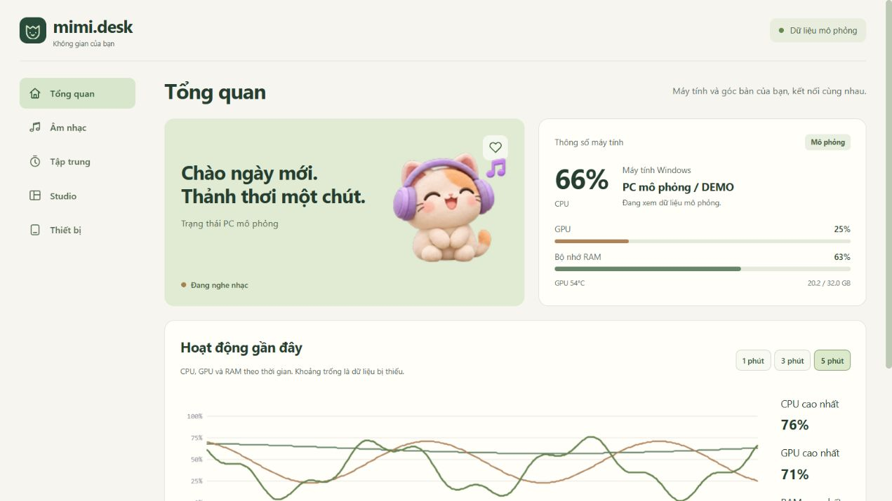

# mimi.desk Web và desktop

Mốc nguồn v2.11.0-dev đổi tên hiển thị thành **mimi.desk** và áp dụng hướng ấm áp, gọn, hiện đại đã được người dùng chọn.

## Đã thay đổi

- Web có sidebar trên desktop và thanh điều hướng cuộn ngang trên màn hẹp. Âm nhạc và Tập trung tách riêng; Studio và Thiết bị giữ các công cụ hiện có.
- Tổng quan gọn hơn, thống nhất màu biểu đồ, bỏ vòng CPU trang trí và nội dung đánh số. Trạng thái mô phỏng vẫn được nêu rõ.
- Chẩn đoán kết nối/hiệu năng và các công cụ CatPack/JSON nâng cao được thu gọn. Các endpoint, file và thao tác lưu vẫn dùng hợp đồng cũ.
- App Python có sidebar cùng tên/biểu tượng, khung Music dễ đọc và chỉ lấy chiều cao trang đang mở. Cấu hình, credentials và namespace cũ vẫn được đọc ở vị trí cũ.
- Badge kết nối trên app dựa vào phản hồi thiết bị gần nhất; sau sáu giây không có phản hồi thì không giữ trạng thái Đã kết nối.
- Các trường firmware vẫn cập nhật bằng luồng chọn file hiện có. Hai chế độ OTA server nằm trong [đề xuất riêng](SERVER_OTA_PROPOSAL.md), chưa được bật trong app hoặc bo.

## Kiểm tra tập trung

Chạy nhóm smoke GUI liên quan tới các tab/preview/đồng bộ; kiểm tra cú pháp JS nhúng và trạng thái WebSocket; build firmware chứa giao diện mới. Không chạy lại toàn bộ Python/C++/JS hoặc chờ CI đầy đủ trong lượt redesign này theo yêu cầu tăng tốc dev.

Web đã quan sát ở desktop và 390px: không tràn ngang, canvas Studio co theo vùng chứa. Đã quan sát Overview và Music của app trong DEMO. Người dùng đang tương tác với cửa sổ preview; không tự khởi động lại cửa sổ đó để thay các chỉnh sửa cuối. Các ảnh xem trước là dữ liệu mô phỏng, không phải đo từ phần cứng.

## Phân biệt DEMO và nhạc thật

Người dùng xác nhận cửa sổ gặp hiện tượng không nhận Spotify có tiêu đề `DEMO / Xem trước`. Chế độ này chỉ dùng nhạc mẫu, không đọc phiên nhạc Windows và không lưu cấu hình thiết bị. Chưa có bằng chứng tái hiện lỗi do mở Spotify trước app ở chế độ thật.

App đã thêm giải thích trên mọi trang DEMO, mô tả riêng tại Âm nhạc và nút **Mở chế độ thật**. Nút mở cửa sổ riêng bằng cấu hình đã lưu, không chuyển IP hoặc mã ghép nối trong DEMO qua dòng lệnh. Cửa sổ thật luôn hiện khi mở từ nút này, kể cả khi đã chọn khởi động thu nhỏ. Nếu chưa kết nối, nhập lại thông tin tại **Thiết bị** trong cửa sổ thật.

Chạy từ source ở thư mục dự án: `.venv/Scripts/pythonw.exe windows_agent/companion.py --show`. Thêm `--preview` chỉ khi muốn xem bố cục với dữ liệu mẫu. Cửa sổ DEMO đã mở trước khi sửa cần mở lại để thấy nút mới.

Kiểm tra bổ sung: 7 bài smoke GUI đã qua, gồm mở chế độ thật từ source/EXE, chặn nhấn lặp và cho phép thử lại khi không mở được tiến trình. Chưa xác minh phát nhạc Spotify thật; không build lại hoặc OTA firmware cho thay đổi Python này.

## Chưa triển khai

Chưa OTA lên thiết bị, chưa phát hành binary lên server, chưa tự cập nhật EXE Windows và chưa đổi bootloader/phân vùng. `MeoDesk` trong định danh giao thức, đường dẫn dữ liệu và tên package cũ là tương thích kỹ thuật, không phải tên hiển thị bị bỏ sót.
