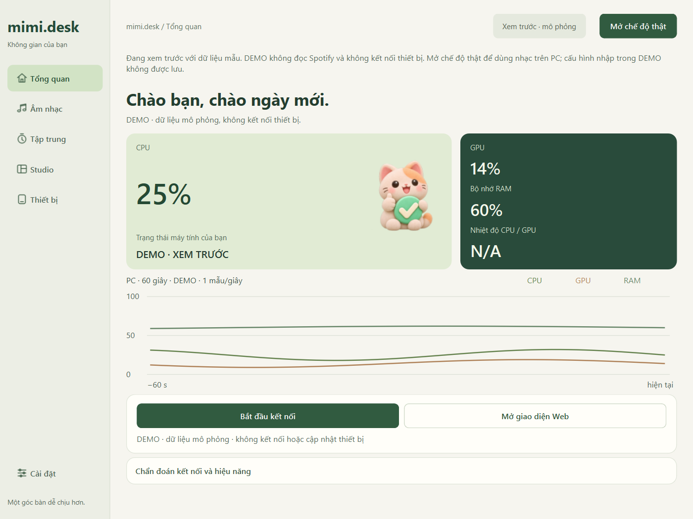

# mimi.desk 2.15.0-rc.1 · bàn giao trước deploy

Đã hoàn thành các đợt phần mềm v2.12 → v2.15 theo phạm vi đã chốt. Source được push từng mốc. Bộ RC gồm app Windows portable/cài theo người dùng, firmware cầu nối riêng, firmware chung, manifest/checksum và thư mục staging server. Không tự nạp bo, thay bootloader/phân vùng, phát hành binary lên Internet hoặc bật Auto trên thiết bị.

## Đã hoàn thành

| Mốc | Kết quả |
|---|---|
| Windows v2.12 | Một phiên GUI, đọc Spotify độc lập với mạng thiết bị, cache ảnh bìa, tìm phiên đã mở, reconnect/backoff và tìm đúng device ID |
| v2.13 | ESP32 tự đọc manifest và tải firmware A/B; hai chính sách, revision, tương thích SemVer/board/layout, gộp bản chờ, lease OTA/CatPack và NVS cầu nối |
| v2.14 | Web/Qt cùng quản lý chính sách, tiến độ và lỗi; journal xác nhận OTA sau mở lại, AP pairing, giữ bản nháp Studio/rules và phát hiện xung đột revision/boot |
| v2.15 RC | Đóng gói EXE có icon/version, hỗ trợ cài/nâng cấp/gỡ tích hợp theo người dùng, chẩn đoán không chứa bí mật, staging/publisher và hướng dẫn vận hành |

Đã bổ sung kiểm tra revision của policy khi nhận kết quả manifest đang tải: kết quả từ chính sách cũ không được áp vào kênh vừa đổi. Bản đích thủ công đã nhận không bị thay thế chỉ vì manifest kênh đổi trong lúc đang chờ. Các giai đoạn ghi/xác minh/reboot vẫn chỉ có một lượt đang chạy. TFT cập nhật tiến độ khi phần trăm thay đổi để tránh vẽ lại màn 0% theo từng khối dữ liệu.

## Artifact trên máy phát triển

Các file nhị phân không nằm trong Git; checksum và báo cáo kiểm tra nằm trong `release/`.

- `dist/mimi.desk-2.15.0-rc.1-Windows-x64.zip`: app portable, script cài/gỡ và danh sách dependency. Gói đầy đủ không cần Python trên máy nhận.
- `dist/mimi.desk/mimi.desk.exe`: chạy ngay từ thư mục đã giải nén. Thoát bản cũ từ khay hệ thống trước khi dùng bản mới lần đầu.
- `release/mimi_desk_v215rc1_private_bridge.bin`: build dùng cấu hình riêng, chỉ dùng cho thiết bị của chủ dự án, không upload lên hosting công khai.
- `release/mimi_desk_v215rc1_public_firmware.bin`: build chung không nhúng Wi-Fi/key của máy phát triển, dùng cấu hình NVS đã chuyển.
- `release/mimi_desk_v215rc1_builds.json`: kích thước/hash của firmware và ZIP, phạm vi kiểm tra và các mục chờ nghiệm thu.
- `release/mimi_desk_v215rc1_windows_checks.json`: kết quả self-check của chính EXE và kiểm tra 21 trường hợp trang/kích thước.
- `dist/ota-v215/`: cây `channels/preview.json` và `releases/<id>/` đã tạo bằng publisher. URL đang dùng miền `.invalid` để đánh dấu chưa chọn hosting; không đưa cây này vào Auto trên thiết bị.

Chạy `install.ps1` trong thư mục giải nén để cài vào `LocalAppData/Programs/mimi.desk`. Không tự bật startup nếu chưa chọn; nâng cấp giữ cấu hình `LocalAppData/MeoDesk` và kho mã ghép nối. `uninstall.ps1` gỡ shortcut/startup, giữ dữ liệu và cho phép tự xoá thư mục chương trình sau khi thoát. Chính sách PowerShell trên máy này chặn script chưa ký: có thể dùng chế độ portable, hoặc lệnh cho riêng tiến trình được ghi trong `README-WINDOWS.txt`; không đổi policy lưu trên máy.

## Kiểm tra đã thực hiện

- 43 kiểm thử Python tập trung vào GUI/update/publisher/staging/nhạc/vòng đời/chẩn đoán đã qua. Không chạy lại toàn bộ bộ kiểm thử theo yêu cầu tăng tốc dev.
- Ba kiểm thử C++ native: SemVer/lease, OTA manager và CatPack với API Flash mô phỏng; các kiểm thử JS update/boot/shared state/scene/rules đã qua.
- Hai build firmware riêng/chung đã qua với Arduino/toolchain hiện tại; image đều nằm trong slot 6 MiB. Đã kiểm tra binary public không có giá trị Wi-Fi password/API key riêng đang dùng ở máy phát triển.
- Bản EXE đã qua self-check: Qt, SVG, assets, keyring, WinRT và ảnh bìa Spotify 8.192 byte. Lúc kiểm tra, Spotify thật đang phát; báo cáo không ghi tên bài hoặc nghệ sĩ.
- Chính EXE đã render bảy trang ở ba kích thước, tổng 21 trường hợp, không cuộn ngang và không khởi động worker thiết bị trong DEMO. Lặp kiểm tra với `QT_SCALE_FACTOR=1` và `1.5`; ảnh mặc định được chụp trên desktop đang scale 125%. Đây chưa phải nghiệm thu nhiều máy Windows khác nhau.
- Web đã render bằng Chromium ở desktop và 390 px; bảng cập nhật không tràn ngang. Ảnh chỉ dùng dữ liệu mô phỏng.
- Đã phát hiện và sửa DLL ICU bị PyInstaller lấy nhầm từ một công cụ khác trên PATH; self-check EXE sau sửa đã qua. Luồng self-check media dùng worker và Qt event loop để không chặn COM/UI.

## Luồng phát hành sau khi chốt hosting

1. Chọn origin HTTPS và nơi chứa binary/manifest. Dùng `packaging/ota/nginx-location.conf` làm mẫu: manifest kênh không cache lâu, URL release bất biến cache dài.
2. Dùng `firmware/tools/publish_update.py` với binary public, version, sequence tăng dần và URL artifact thật để tạo staging mới. Không sửa nội dung release cũ tại cùng URL. Workflow `Prepare release for review` chỉ build/stage thành artifact; không có quyền tự publish.
3. Kiểm tra manifest/size/hash, upload thư mục release trước, kiểm tra tải được, rồi mới thay con trỏ kênh. Mỗi lượt build không tự trở thành release OTA.
4. Cài firmware cầu nối một lần bằng OTA Wi-Fi hiện có để chuyển Wi-Fi/key/AP vào NVS và thêm reader. Giữ bản riêng ở máy. Sau đó các release public có phiên bản cao hơn được thiết bị tự tải.
5. Chọn **Kiểm tra và thông báo** cho lượt đầu, nhập URL manifest và bấm kiểm tra. Chỉ sau nghiệm thu mới cân nhắc Auto. Auto mặc định hoãn Focus và báo trước 10 giây trước tải; không ngắt lượt Flash đang chạy.

Bản cầu nối mới nhất và binary public cùng là 2.15.0-rc.1, nên reader không tự ghi lại cùng phiên bản. Có thể nạp cầu nối mới nhất rồi chờ release cao hơn; nếu muốn nghiệm thu ngay luồng pull của RC này, có thể dùng bản cầu nối v2.13-dev đã giữ ở máy rồi tải public RC mới hơn, sau khi chốt lượt thử trên bo. Không đổi version trong manifest để giả làm firmware khác.

## Những việc cần thảo luận/nghiệm thu tiếp

Danh sách chi tiết kèm mức ưu tiên, phương án và mốc dự kiến: [các vấn đề cần thảo luận và update tiếp theo](NEXT_DISCUSSION_AND_UPDATES.md).

- Hosting thật và quyền phát hành, chu kỳ preview/stable, thời điểm bật Auto cho thiết bị dùng hằng ngày.
- Một lượt OTA có kiểm soát trên bo, xác minh slot/device/boot/health; thử mạng đứt, mất nguồn và đường phục hồi/rollback với bootloader thực tế.
- TFT Music/font tiếng Việt, đồng hồ Midnight từng giây, FPS/heap khi TLS chạy cùng renderer, Focus và đồng bộ Web/app trên phần cứng.
- Cài/chạy/nâng cấp/gỡ trên Windows sạch và các provider/cảm biến thực tế. Gói đã chạy trên máy phát triển, không thay cho nghiệm thu Windows sạch.
- Chưa có tự nâng cấp EXE Windows trong nền. Có gói portable và script nâng cấp chủ động; firmware OTA là luồng riêng.

Các hạng mục nền tảng nhiều thiết bị/màn hình khác, pack animation mới, beat audio, tích hợp lịch/thời tiết và hardening bảo mật giữ ở roadmap tương lai, không nằm trong bốn mốc hoàn thiện này. Chưa gắn nhãn stable.
