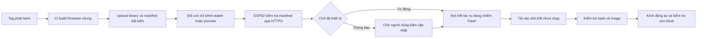

# Đề xuất OTA từ máy chủ cho mimi.desk

Ngày 21/11/2026. Người dùng chọn hai chế độ có thể đổi từ Web hoặc app: **tự kiểm tra, bấm cập nhật** và **tự cập nhật khi có bản mới**. Reader/API/publisher đã được triển khai ở [v2.13](SERVER_OTA_V213.md); tài liệu này giữ cơ sở thiết kế. Chưa dựng hosting thật, bật tự cập nhật hoặc ghi firmware lên bo.

## Luồng đề xuất



ESP32 tự tải firmware; máy tính không phải giữ app chạy hoặc gửi file. Web/app đặt chính sách và theo dõi trạng thái do cùng một ESP32 quản lý. Git push thông thường không phát hành OTA: chỉ release được chọn mới làm thay đổi kênh cập nhật.

[ESP HTTPS OTA](https://docs.espressif.com/projects/esp-idf/en/stable/esp32s3/api-reference/system/esp_https_ota.html) cung cấp luồng tải HTTPS và ghi OTA. Cách tích hợp cụ thể phải khớp ESP-IDF trong Arduino core đang dùng; không mặc định lấy tính năng resume của IDF mới nhất làm khả năng đã có.

## Hai chế độ trên app và Web

| Chế độ | Thiết bị làm gì | Người dùng thấy gì |
|---|---|---|
| Kiểm tra và thông báo · mặc định | Kiểm tra manifest, ghi nhận bản tương thích mới, chờ thao tác | Phiên bản hiện tại → bản mới, ghi chú và nút Cập nhật |
| Tự cập nhật | Kiểm tra, chọn bản mới nhất tương thích và bắt đầu khi điều kiện cho phép | Trạng thái chờ/tải/xác minh/khởi động; có thể đổi về chế độ thông báo |

Chính sách nằm trên ESP32 và được lưu NVS khi thực sự thay đổi. Đóng app hoặc tắt PC không đổi chế độ. Web và app đọc cùng `update_policy_revision`, không tự lưu hai bản chính sách riêng.

API dự kiến:

- `GET /api/v1/update-policy`: chế độ, kênh, chu kỳ kiểm tra và revision.
- `POST /api/v1/update-policy`: gửi chính sách và `expected_revision`; nếu một giao diện khác vừa đổi, trả xung đột để tải lại dữ liệu.
- `POST /api/v1/update/check`: yêu cầu kiểm tra ngay, có command ID chống lặp.
- `POST /api/v1/update/start`: cập nhật bản được nêu rõ bằng release ID; firmware kiểm tra lại tương thích và chính sách trước khi ghi.
- Trạng thái cập nhật đi cùng WebSocket state hiện có, có HTTP dự phòng.

Thông tin chính trên UI: phiên bản hiện tại, phiên bản đang chờ, chế độ, kênh, lần kiểm tra gần nhất và tiến độ. Hash, slot, HTTP và mã lỗi nằm trong Chẩn đoán. Không dựng phần trăm giả cho giai đoạn đang chờ reboot/xác nhận.

## Xử lý nhiều phiên bản và yêu cầu đồng thời

Thiết bị giữ **một lượt đang chạy** và **một bản đích mới nhất đang chờ**. Không xếp hàng mọi release.

| Tình huống | Cách xử lý |
|---|---|
| Chưa tải A, server phát hành B rồi C | Gộp bản chờ thành C nếu tương thích; bỏ qua A/B |
| Đang ghi A, B/C xuất hiện | Tiếp tục xác minh A, không mở lượt ghi thứ hai. Sau khi A khởi động ổn định, kiểm tra lại kênh và chỉ giữ C |
| Web và app cùng bấm Cập nhật | Command ID chống lặp và khoá OTA toàn thiết bị trả về cùng lượt đang chạy hoặc Busy; không bắt đầu hai lượt |
| Đang cài CatPack hoặc OTA thủ công | Cùng dùng UpdateCoordinator; firmware/CatPack không đồng thời chiếm Flash |
| Đổi Auto → Thông báo trong lúc ghi | Hoàn tất lượt đang chạy; không tự bắt đầu bản tiếp theo. UI nêu rõ lượt hiện tại đang hoàn tất |
| Auto và một yêu cầu thủ công khác phiên bản | Chỉ lượt đã nhận khoá được chạy. Yêu cầu sau không chen ngang; người dùng được báo bản đang chạy và bản còn chờ |
| Hash của cùng một release thay đổi | Từ chối artifact đã bị thay thế. Phát hành bản mới bằng release ID mới |
| Bản mới lỗi nhiều lần | Backoff và giới hạn số lần tự thử trên cùng release ID; chờ bản khác hoặc thao tác thử lại có chủ đích |
| Thiết bị đang chạy bản cao hơn kênh | Không tự hạ phiên bản. Downgrade phải là thao tác riêng |
| Manifest cũ quay lại do cache | So sánh sequence và phiên bản, không đảo ngược bản đang chờ vì một phản hồi cũ |

Mỗi lượt giữ bản sao bất biến của manifest đã chọn. Nếu kênh đổi khi đang tải, hash/URL của lượt đang chạy không thay đổi theo. Sau một lượt thành công có khoảng nghỉ ngắn trước khi xét lượt tiếp để tránh vòng khởi động lại khi phát hành dồn dập.

Đề xuất ban đầu: kiểm tra định kỳ 1–2 phút trong kênh preview, thưa hơn ở stable; có jitter, backoff và HTTP cache. Chu kỳ thực tế phụ thuộc nơi host manifest. Có nút Kiểm tra ngay; không gọi API GitHub liên tục từ từng bo.

## Manifest và phát hành

Đề xuất **manifest kênh nhỏ** trỏ tới **manifest release bất biến**, rồi tới file firmware. CI upload binary và manifest release trước, chỉ đổi con trỏ kênh sau khi các file đã sẵn sàng. Giữ các binary cũ để điều tra và phục hồi.

Ví dụ cấu trúc release, chưa phải API đang chạy:

```json
{
  "schema": 1,
  "release_id": "stable-2.12.0-1",
  "release_sequence": 212001,
  "version": "2.12.0",
  "channel": "stable",
  "board": "meodesk-esp32s3-n16r8",
  "partition_layout": "meodesk-ab-6m-assets-v1",
  "minimum_firmware": "2.12.0-beta.1",
  "size": 2454800,
  "sha256": "<64 hex characters>",
  "url": "https://updates.example.com/releases/2.12.0/firmware.bin",
  "notes": ["Cải thiện giao diện và độ ổn định"]
}
```

So sánh phiên bản theo SemVer và kiểm tra model/layout; không dùng thứ tự từ điển của chuỗi. Sequence là thứ tự phát hành, không cấp quyền tự downgrade. URL không chứa pairing key hoặc thông tin Wi-Fi.

## Nơi đặt firmware

**Đề xuất ban đầu:** dùng GitHub Releases cho binary/ghi chú và một manifest kênh tĩnh trên HTTPS. [GitHub Releases](https://docs.github.com/en/repositories/releasing-projects-on-github/about-releases) đã hỗ trợ asset tải về và gắn với tag; phù hợp lượt phát hành đầu khi chưa cần server quản lý đội thiết bị.

Server riêng/VPS hoặc máy hiện có phù hợp khi cần điều khiển cache, phát hành theo nhóm thiết bị, dashboard hoặc phản hồi kết quả. Thiết kế reader trên ESP32 giữ chung hợp đồng manifest để đổi hosting không phải viết lại OTA.

Chưa chọn hoặc deploy hosting trong đợt này. Chưa tạo release chứa binary riêng của máy phát triển.

## Bước chuyển từ firmware hiện tại

Firmware hiện tại có OTA nhận file nhưng chưa có reader tự tải manifest. Cần một bản cầu nối được cài **một lần bằng OTA hiện tại qua Wi-Fi**, sau đó mới có thể dùng server OTA; bo đã có A/B không cần thêm lượt đổi phân vùng qua UART cho bước này.

Bản phát hành chung cần đọc cấu hình thiết bị từ NVS. Không đưa bản build chứa SSID, mật khẩu hoặc pairing key riêng lên server công khai. Nếu pairing key hiện vẫn là hằng biên dịch, bản cầu nối cần chuyển cấu hình đó sang NVS trước khi thay bằng firmware chung; phải kiểm tra việc giữ kết nối với app đã ghép nối.

Giữ engine ghi A/B, kiểm tra hash và health check hiện có làm nền. Bổ sung nhận diện device/boot/release để trạng thái sau reboot không bị nhận nhầm. Khả năng rollback của bootloader cần kiểm tra trên bo trước khi bật chế độ Auto cho sử dụng thường xuyên.

## Những điểm cần chốt khi triển khai

1. Nơi host manifest/binary: GitHub kết hợp manifest tĩnh, hoặc server riêng.
2. Điều kiện chờ của Auto: có hoãn trong Focus đang chạy hay không; thời gian báo trước reboot.
3. Kênh mặc định và chu kỳ kiểm tra; Auto áp dụng cho release được phát hành, không áp dụng mọi commit dev.
4. Cách phát hành bản cầu nối để giữ Wi-Fi/key và cấu hình hiện tại.

Kiểm thử cần tập trung vào khoá OTA, gộp release, manifest sai/hash sai, mạng đứt và xác nhận sau reboot. Không cần chạy lại toàn bộ kiểm thử UI cho mỗi thay đổi publisher hoặc chính sách.
