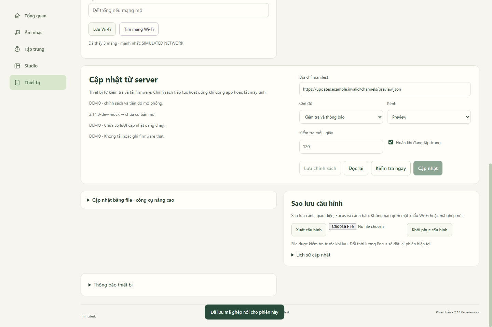
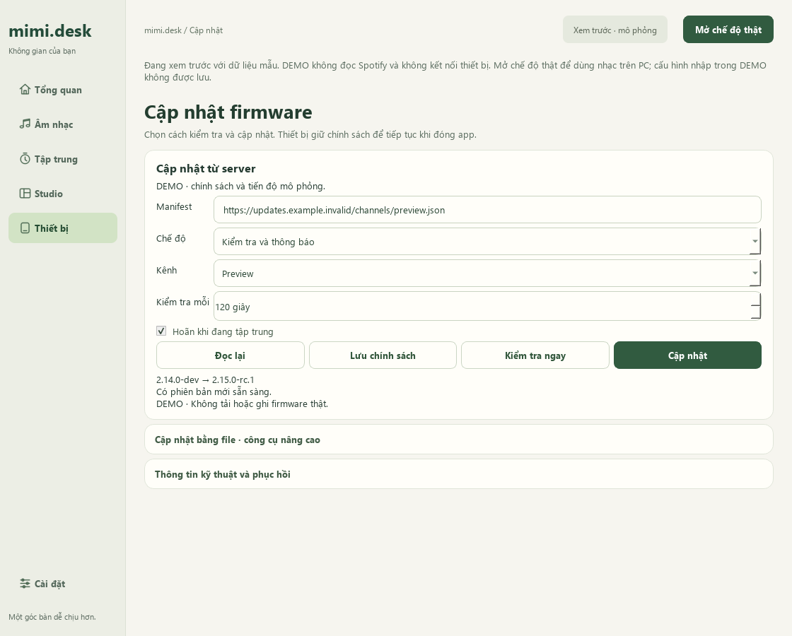

# mimi.desk v2.14.0-dev · luồng cập nhật và Studio

Web và Windows đã có cùng bảng OTA server: manifest, chế độ thông báo/tự cập nhật, kênh, chu kỳ, hoãn Focus, bản đang chạy và bản chờ. Các giá trị được đọc từ ESP32; thao tác lưu dùng revision để phát hiện xung đột. Bản nháp không tự mất khi giao diện khác lưu thay đổi. Firmware cũ trả 404 được hướng sang cập nhật bằng file.

Công cụ file thủ công và thông tin kỹ thuật nằm trong phần mở rộng. Tiến độ chỉ có phần trăm khi biết số byte tải; kiểm tra server hoặc chờ reboot dùng trạng thái chờ. Trong lúc thiết bị ghi Flash, WebSocket phát gói trạng thái cập nhật gọn thay vì ngừng phản hồi hoàn toàn.

## Thiết lập ban đầu và trạng thái lưu

- Mục Thiết bị hướng dẫn tìm thiết bị → nhập mã → lưu và kết nối. Firmware chung mới có thể cấp mã qua AP thiết lập, khi thiết bị chưa kết nối router; mã không xuất hiện trong status công khai.
- Điều khiển Studio có phản hồi Đang áp dụng/Đã áp dụng. Bố cục và quy tắc JSON có base revision cùng boot ID. Nếu Web/app sửa đồng thời hoặc bo reboot, firmware mới trả xung đột; client giữ bản nháp và đề nghị đọc lại. Client cũ không gửi revision vẫn dùng giao thức cũ để tương thích.
- Các thông báo thường gặp về nhạc, kết nối, sao lưu và cập nhật đã được chỉnh lại tiếng Việt; tên bài, nhãn do người dùng nhập và mã kỹ thuật được giữ nguyên.
- Mở mục khác đưa Web về đầu trang; dropdown giữ thao tác native và bố cục bảng cập nhật co về một cột trên mobile.

## Tiếp tục lượt OTA chưa xác nhận

Windows lưu job ID, device ID, boot ID cũ, slot đích, phiên bản và hash trước khi gửi. Journal không chứa mã ghép nối hoặc mật khẩu. Mở lại app chỉ tiếp tục xác minh; không tự gửi lại binary. Có thể chủ động kiểm tra lượt trước trong công cụ nâng cao. Xác nhận đối chiếu thiết bị, boot mới, phiên bản nếu manifest có và startup health. Khi mất địa chỉ, chỉ tìm lại thiết bị trùng ID qua discovery có giới hạn.

Thoát trong lúc upload file sẽ đợi hoàn tất lượt gửi rồi đóng app; mở lại để xác nhận. Luồng chờ xác minh có thể dừng khi thoát. Web lưu thông tin lượt trong localStorage, không lưu binary hoặc mã ghép nối vào journal; có nút kiểm tra lại. Web chỉ xác minh tại địa chỉ đang mở, không quét LAN.

## Bằng chứng và phạm vi còn lại

Đã chạy 29 kiểm thử Python liên quan GUI/OTA/workflow cùng các kiểm thử JS về update, boot, shared state, scene và rules. Có kiểm tra giữ base revision khi bản nháp bẩn, thiếu endpoint ở firmware cũ và journal không ghi bí mật. Firmware public đã build; build cuối và hash được ghi trong receipt phát hành.

Đã render Web bằng Chromium ở 1.440 px và 390 px, không có tràn ngang, cùng trang cập nhật Qt. Ảnh là dữ liệu DEMO, không phải cập nhật thực tế:

Chưa nạp lên bo; kiểm tra nhiều thiết bị, DHCP/TLS trên ESP32, mất nguồn, rollback và Windows sạch thuộc lượt nghiệm thu phần cứng/RC. Không tự bật Auto hoặc đặt server thật trong đợt này.
